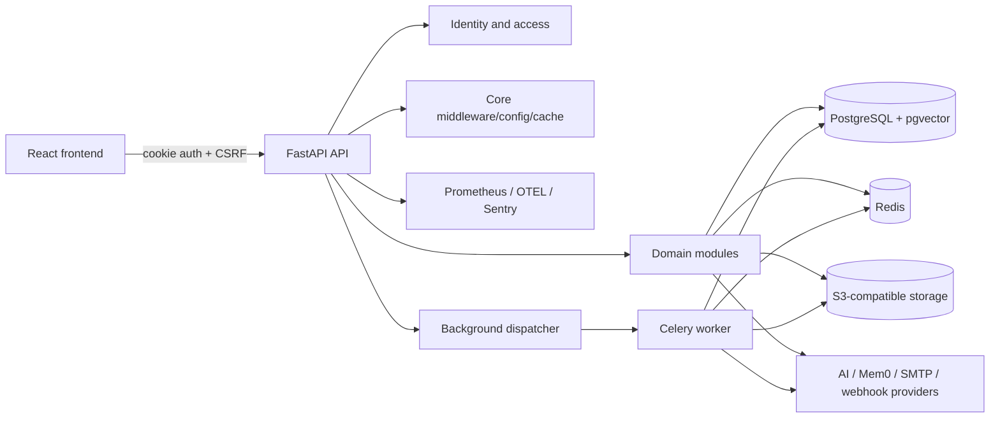
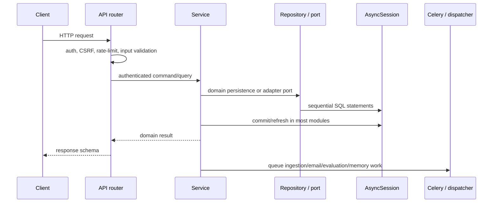

# Current architecture

Status: `VERIFIED` for Phase 00, based on source inspection and the validation record in [`docs/modernization/phases/PHASE_00.md`](../modernization/phases/PHASE_00.md).

Audit date: 2026-11-24.

## Executive summary

Fullstack Blueprint is a Python/FastAPI and React application implemented as a modular monolith. The backend is composed in `backend/api`, shares infrastructure through `backend/core`, `backend/db`, and `backend/lib`, and keeps business capabilities under `backend/modules`. Celery workers execute background work in the same repository and use Redis as broker/result infrastructure. PostgreSQL is the system of record; pgvector and PostgreSQL full-text search support RAG when enabled.

The repository has a healthy executable baseline: backend and frontend tests pass, Ruff/ESLint/TypeScript/API-contract checks pass, the frontend production build passes, and Alembic reports no drift against the configured database. The primary architectural risks are boundary consistency and production hardening, not a need to split the application into services.

## Verified repository shape

| Area | Evidence observed |
| --- | --- |
| Backend | 304 Python files excluding `.venv`, 46 test files, 123 FastAPI route decorators |
| Frontend | React/TypeScript/Vite app; 350 source TS/TSX files and 49 test/spec files |
| Persistence | 36 SQLAlchemy tables registered from 12 model modules |
| Migrations | One revision, `0001_blueprint`, creating the complete baseline; downgrade intentionally raises |
| API composition | `backend/api/main.py` installs middleware and lifespan; `backend/api/router.py` composes `/api/v1` |
| Background work | Celery tasks plus an eager/local dispatcher in `backend/workers` |
| Optional capabilities | AI, RAG, memory, calendar, and observability are configuration-gated; platform module packs/flags add runtime gating |
| External adapters | HTTP AI providers, Mem0, S3-compatible storage, SMTP, webhooks, Redis, PostgreSQL, OTLP, Prometheus, Sentry |

## Runtime topology

## Request and transaction path

The intended pattern is route -> service -> repository/port -> infrastructure. The audit found exceptions: admin, notification, platform, settings, and user routes contain direct SQL or direct commits. Those exceptions are tracked in the backlog.

## Backend layers

| Layer | Location | Responsibility |
| --- | --- | --- |
| API/composition | `backend/api`, module `router.py`/`routes.py` | Router registration, request parsing, response mapping, cross-cutting middleware/dependencies |
| Application | module `service.py`, `application/` | Use cases, authorization orchestration, transaction coordination, provider selection |
| Domain | module `domain/`, models and policies | Value objects, policy decisions, domain representations; strongest in memory and RAG |
| Persistence | module `repository.py`, RAG infrastructure repositories | SQLAlchemy queries and writes, pagination, model persistence |
| Ports | `backend/lib`, provider/reranker protocols | Narrow abstractions for project access, generation, platform reads, and external providers |
| Infrastructure | `backend/core`, `backend/db`, module `infrastructure/`, `backend/workers`, `backend/observability` | Settings, sessions, cache, storage, external SDKs, job runtime, telemetry |

## Module map

| Module | Owns | Public entrypoints | Important dependencies |
| --- | --- | --- | --- |
| `identity_access` | Users, refresh sessions, password/MFA/email flows | `/api/v1/auth/*` | Redis, auth dependencies, email dispatch |
| `users` / `profile` | User self-service and profile/avatar data | `/api/v1/users/*`, `/api/v1/profile/*` | Identity models, object storage |
| `projects` | Projects, owner/editor/viewer membership, tasks | `/api/v1/projects/*` | Users, notifications, project access port |
| `ai` | Prompt templates/versions, runs, agents, reviews, evaluations, compatibility document routes | `/api/v1/ai/*`, `/api/v1/agent/*` | Providers, RAG compatibility, memory, workers |
| `rag` | Document storage, parsing, chunking, embeddings, immutable revisions, retrieval, citations | `/api/v1/rag/*` | PostgreSQL/pgvector, object storage, project access, workers |
| `memory` | Mem0 adapter, memory policy/routing, local audit and registry | `/api/v1/memory/*` | Mem0, project access, Redis, workers |
| `platform` | Module packs, flags, plans/subscriptions, API keys, webhooks, email templates | `/api/v1/platform/*` | Settings, external HTTP, audit |
| `notifications` | Notifications and preferences | `/api/v1/notifications/*` | User identity |
| `calendar` | User calendar entries and project linkage | `/api/v1/calendar/*` | Projects |
| `settings` | Admin-managed database settings and environment metadata | `/api/v1/settings/*` | Admin auth, environment file store |
| `audit` | Audit model, repository, request audit helper | No standalone router | SQLAlchemy; used across modules |
| `admin` | Administrative user/audit/metrics views | `/api/v1/admin/*` | Identity, notifications, audit |
| `observability` | Metrics, traces, Sentry and dashboard/status links | `/metrics`, `/api/v1/observability/*` | Prometheus, OTEL, Grafana, Tempo |

## Current strengths

- Optional modules are gated at both router registration and service/configuration boundaries.
- Authentication validates JWT type, user activity, and the backing refresh session.
- Cookie-authenticated unsafe requests are protected by a double-submit CSRF check.
- Project membership checks are reused by projects, RAG, and memory through `ProjectAccessPort`.
- RAG owns ingestion and records index revisions; AI document routes delegate to the RAG compatibility service.
- API keys are stored as hashes, not plaintext keys.
- Async provider/storage work uses `httpx.AsyncClient` or `asyncio.to_thread` for blocking SDK calls.
- The Alembic environment imports all model modules and `alembic check` reports no pending operations.

## Current inconsistencies and coupling

1. Static import analysis found cycles involving observability/session initialization and the worker task/dispatch modules. Tests pass, but the cycles rely partly on local imports and should be made explicit through composition roots and ports.
2. `PlatformService` and several capability services use inheritance as a compatibility facade (`BillingService`, `WebhookService`, `FeatureFlagService`, and others), despite the repository principle preferring composition.
3. Some routers perform SQL queries or `db.commit()` directly. This makes transaction ownership and authorization review less uniform.
4. `ai` retains legacy document routes through `rag.application.legacy_ai_document_service`; compatibility is intentional but creates a second public vocabulary for documents.
5. Project and organization identifiers in RAG and memory infrastructure are strings without database foreign keys. Runtime ACLs exist, but referential integrity is not enforced by PostgreSQL.
6. The single baseline migration is intentionally non-downgradeable. This is acceptable for a new empty schema but is not a safe long-lived migration history for data-bearing deployments.
