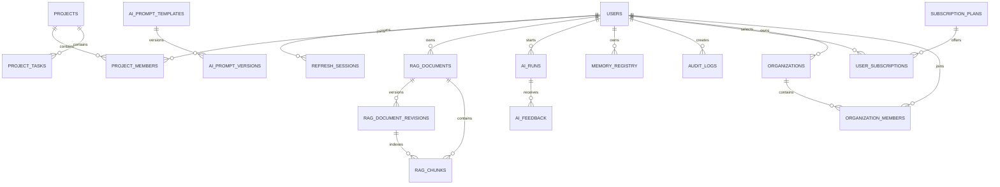

# Data model

## Baseline

The current schema is registered in `backend/alembic/env.py` and evolves additively
through `0007_organizations`. `0001_blueprint` remains the new-schema baseline and
intentionally refuses to run over a non-empty application schema; later revisions add
outbox, AI, agentic, RAG/memory, reusable capability, and organization tables.

## Domain groups

## Tables by owner

| Owner | Tables |
| --- | --- |
| Identity | `users`, `refresh_sessions` |
| Organizations | `organizations`, `organization_members` |
| Projects | `projects`, `project_members`, `project_tasks` |
| Profile/notifications/calendar | `user_profiles`, `notifications`, `notification_preferences`, `calendar_entries` |
| Platform/settings | `app_settings`, `subscription_plans`, `user_subscriptions`, `api_keys`, `webhook_endpoints`, `feature_flags`, `email_templates` |
| Audit | `audit_logs` |
| AI | `ai_prompt_templates`, `ai_prompt_versions`, `ai_runs`, `ai_review_items`, `ai_feedback`, `ai_evaluation_datasets`, `ai_evaluation_cases`, `ai_evaluation_runs`, `ai_evaluation_run_items` |
| RAG | `rag_documents`, `rag_document_revisions`, `rag_chunks`, `rag_queries`, `rag_ingestion_jobs`, `rag_conversations`, `rag_retrieval_traces`, `rag_messages` |
| Memory | `memory_audit_logs`, `memory_registry` |

## Integrity and indexing

- User-owned records generally have foreign keys with `CASCADE` or `SET NULL` semantics.
- Project membership has a unique `(project_id, user_id)` constraint.
- RAG chunks have vector HNSW and full-text GIN indexes plus document/user/project/revision indexes.
- RAG ingestion has a partial unique index preventing multiple active jobs for a document.
- API keys, users, settings, flags, templates, and plans have unique business keys.
- Refresh tokens and API keys are indexed by their hash.

## Baseline gaps

- `user_subscriptions.user_id` is not unique, although the service expects at most one subscription per user. Add a data-audited unique constraint before relying on that invariant under concurrency.
- RAG and memory `project_id` values are strings without foreign keys to `projects`. Runtime access checks are present; add a compatibility-safe constraint or a documented reason to keep the loose coupling.
- Organization membership is now an explicit tenant boundary; resource-specific access checks remain required at each retrieval and indexing boundary.
- Many status/role/interval fields are strings without database checks. Keep validation in schemas today and add compatible checks once all callers are inventoried.
- The baseline migration has no reversible downgrade. Future migrations must be additive and provide recovery steps for data movement.

## Data lifecycle

- User/session/project primary ownership uses database cascades.
- RAG documents are soft-deletable with `deleted_at`; revisions/chunks remain governed by document lifecycle and indexing policy.
- Memory content remains in Mem0; Postgres stores registry/audit references and soft-delete state.
- Audit and retrieval traces are operational records; retention and redaction policies need to be made explicit before production scale.

