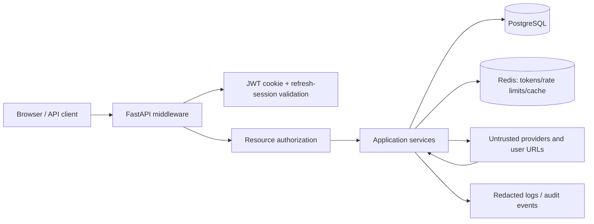

# Security model

Status: `VERIFIED` for controls observed in source; findings are tracked in [`docs/modernization/RISK_REGISTER.md`](../modernization/RISK_REGISTER.md).

## Trust boundaries

All user content, documents, memories, model output, webhook payloads, and external responses are untrusted. Provider responses do not override application authorization or system policy.

## Authentication

- Access JWT and refresh token are delivered in HTTP-only cookies.
- Refresh tokens are random, stored only as SHA-256 hashes, rotated on refresh, and revocable by session.
- Access token validation checks token type, user existence/activity, and active refresh session ownership.
- Password hashing uses Argon2 through Passlib and runs in a worker thread to avoid blocking the event loop.
- Email verification, password reset, sign-in, and sign-up paths are rate limited.
- TOTP MFA is supported and is enforced when enabled for the user.

## Request protection

- Unsafe cookie-authenticated requests require a matching CSRF cookie and `X-CSRF-Token` header.
- Security headers and CORS are installed centrally.
- Public and authentication-specific rate limits use Redis.
- Trusted proxy headers are accepted only from configured proxy IPs.
- Production hides OpenAPI, readiness, and version endpoints unless explicitly enabled.

## Authorization

- Admin operations use `get_admin_user` after normal authentication.
- User-owned resources use user-id predicates at repository retrieval boundaries.
- Project access is owner/editor/viewer membership and is centralized behind `ProjectAccessPort`.
- RAG checks document ownership and project access during retrieval, citation validation, and indexing.
- Memory checks user ownership and project membership before reads/writes/deletes.
- Worker jobs carry user/resource identifiers and re-open a worker-local session.

## Secret handling

| Secret/data | Current handling | Baseline assessment |
| --- | --- | --- |
| JWT signing secret | Settings/environment, minimum length validation | Good; production secret rotation runbook is still needed |
| Passwords | Argon2 hash only | Good |
| Refresh tokens | Hash in database; raw token in cookie only | Good |
| API keys | Hash in database; plaintext returned on create | Good compatibility pattern; never log returned value |
| Provider/storage/SMTP keys | Settings/environment; redacted in logs/settings UI | Good; deployment secret storage remains operational responsibility |
| TOTP secret | Stored in `users.mfa_secret` as a normal string | P1 hardening: encrypt at rest and restrict operational access |
| Webhook signing secret | Stored in `webhook_endpoints.secret` and returned by create response | P1 hardening: encrypt/hash where compatible and support rotation |

## High-priority security findings

1. Webhook destination validation resolves DNS before the request but does not pin the resolved address for the subsequent request. This leaves a DNS-rebinding window. Enforce a trusted egress client that revalidates/pins the destination, and keep the exact allow-list in production.
2. TOTP and webhook signing secrets are plaintext at rest. Add an envelope-encryption adapter backed by deployment secret storage, with a migration and rotation plan.
3. Webhook error text is returned to callers in some paths. Normalize external error responses to safe categories and keep diagnostic detail in redacted logs.

## Security acceptance gates for future phases

- Every resource operation has an authenticated subject and a retrieval-boundary ownership predicate.
- Every unsafe cookie-authenticated write has a CSRF test.
- Every outbound HTTP client has timeout, redirect, egress, and SSRF policy coverage.
- Secret values never appear in logs, API responses after initial issuance, fixtures, or generated frontend bundles.
- Security-sensitive schema changes include migration, rollback/rotation, and incident-recovery instructions.

