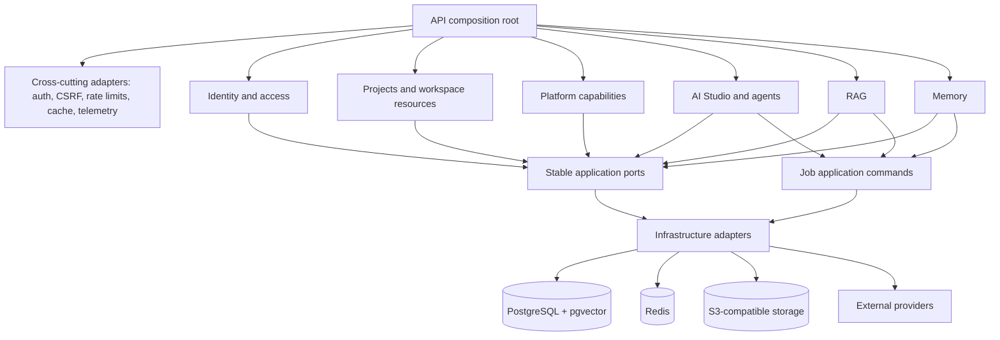
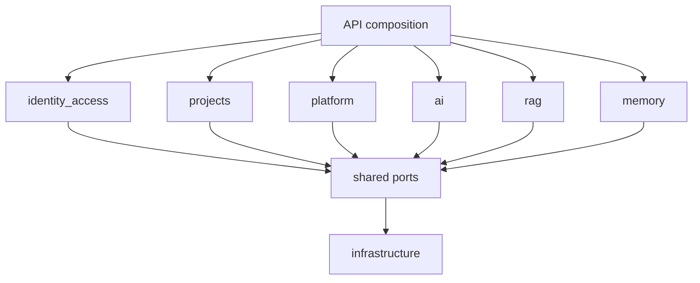

# Target architecture

Status: `IN_PROGRESS` planning baseline. This document describes the target after the modernization program; it is not a claim that all target properties are implemented.

## Direction

Keep the modular monolith. Improve internal boundaries, dependency direction, security, transaction ownership, migration safety, and operational evidence before considering process separation. A service should only be extracted when load, isolation, deployment cadence, or regulatory boundaries demonstrate a measurable need.

## Target topology

## Target rules

- API modules depend on application services, never on another module's repository or SQLAlchemy query.
- Application services depend on domain objects and narrow ports; provider SDKs stay in infrastructure.
- Each command has one transaction owner. Repositories flush; application services commit, or a documented unit-of-work owns the commit.
- Every project-scoped resource resolves access through the project access port at retrieval, mutation, ingestion, and indexing boundaries.
- Optional modules are removable: configuration, router registration, persistence, workers, and UI contracts have explicit seams.
- Compatibility routes remain additive and delegate to the owning module until a versioned API removal is approved.
- Background jobs accept durable identifiers and re-check authorization/ownership in their worker session.
- Database changes are additive by default, use reversible data movement where possible, and are validated against disposable PostgreSQL with pgvector.
- Observability is initialized by the application composition root without importing the database session back into the observability package.

## Target module dependency graph

## Migration sequence

1. Make the baseline measurable: this Phase 00 documentation and repeatable checks.
2. Resolve security blockers: protect MFA/webhook secrets and close outbound request rebind risk.
3. Introduce a transaction/unit-of-work convention and move direct router commits into services.
4. Break static cycles at composition roots and remove multiple-inheritance capability coupling.
5. Add explicit project/resource constraints and safe subscription uniqueness migration.
6. Split AI/RAG compatibility ownership only after contract tests cover both paths.
7. Add production-grade migration, backup, and disposable-service gates to CI.

## Non-goals

- No microservice split during the baseline program.
- No replacement of the working FastAPI, SQLAlchemy, Alembic, Redis, Celery, or pgvector stack without evidence.
- No frontend redesign; backend changes must preserve generated OpenAPI compatibility.
- No destructive migration against an existing environment.
