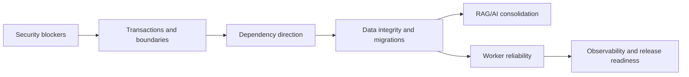

# Modernization master plan

Owner: repository maintainers  
Baseline date: 2026-11-24  
Current phase: `PHASE_11`  
Current phase status: `IN_PROGRESS`

## Program objective

Increase development speed, maintainability, security, extensibility, reliability, and reuse while preserving the modular monolith and existing public behavior. The program is evidence-driven: a task is `VERIFIED` only when its acceptance evidence is recorded.

## Phase status

| Phase | Theme | Status | Exit gate |
| --- | --- | --- | --- |
| 00 | Repository audit and architectural baseline | `VERIFIED` | Audit docs, checks, findings, backlog, and risks recorded |
| 01 | Engineering quality, dependency modernization, and CI/CD | `VERIFIED` | Reproducible quality, test, and security gates |
| 02 | Backend architecture, module boundaries, and API contracts | `VERIFIED` | Enforced route boundaries, deterministic OpenAPI, and durable events |
| 03 | Dependency direction and cycle removal | `NOT_STARTED` | Static import graph has no forbidden cycles |
| 04 | Data integrity and migration safety | `NOT_STARTED` | Additive migrations validated on disposable pgvector PostgreSQL |
| 05 | AI infrastructure modernization | `VERIFIED` | Provider-independent contracts, deterministic routing, durable runs, and versioned streaming |
| 06 | Agentic AI, tools, MCP and durable workflows | `VERIFIED` | Bounded runtime, typed tools, approvals, MCP isolation, and durable checkpoints |
| 07 | Advanced RAG and memory infrastructure | `VERIFIED` | Versioned embeddings, safe ingestion, reproducible retrieval evaluation, and governed memory |
| 08 | Reusable business capabilities | `VERIFIED` | Provider-neutral capability ports, tenant safety, lifecycle records, and focused tests |
| 09 | Production security, observability and deployment | `VERIFIED` | Production validation, correlated telemetry, operational runbooks, and reproducible load/backup procedures |
| 10 | Blueprint generation and AI-assisted development infrastructure | `VERIFIED` | Reproducible profiles, safe updates, generated configuration, and agent workflows |
| 11 | Final integration and production validation | `IN_PROGRESS` | Three generated reference applications, disposable runtime smoke tests, and final review |

## Program rules

- P0 items block production or create security/correctness exposure.
- P1 items are core architecture/productivity work.
- P2 items improve reuse, scale, or operational maturity without blocking the baseline.
- Preserve user data and existing API contracts. Prefer additive migrations.
- Each phase updates `IMPLEMENTATION_STATUS.md`, `CHANGE_LOG.md`, and its phase file.
- Every change records tests, migration impact, security impact, rollback, and the exact next task.

## Workstream ordering

## Definition of done

A phase is complete only when its acceptance criteria are satisfied, actual commands and results are recorded, documentation links are updated, and open limitations are assigned to a later phase or explicitly deferred.

